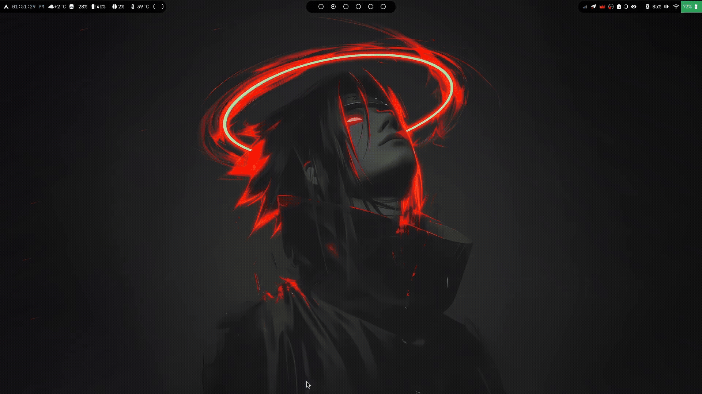
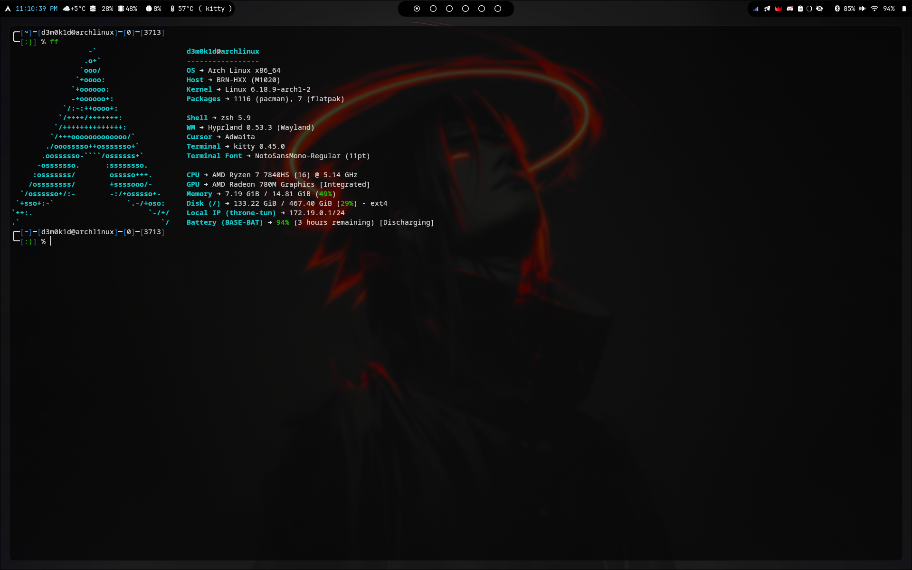

# dots

My personal simple setup for [Hyprland](https://github.com/hyprwm/Hyprland) on my Arch Linux
If you use Hyprland >= 0.55 you can delete .conf global config file because hyprland use on new version lua config file
## Overview


## Core components
- [Hyprland](https://github.com/hyprwm/Hyprland)
- [Quickshell](https://quickshell.org/)
- [Wofi](https://github.com/SimplyCEO/wofi)
- [Hyprlock](https://github.com/hyprwm/hyprlock)
- [NeoVim](https://github.com/neovim/neovim) + [AstroNvim](https://github.com/AstroNvim/AstroNvim)
- [Kitty](https://github.com/kovidgoyal/kitty) + [OhMyZsh](https://github.com/ohmyzsh/ohmyzsh)
- [Hyprshot](https://github.com/another-brother/hyprshot)
- [Fastfetch](https://github.com/fastfetch-cli/fastfetch)
- [Lazygit](https://github.com/jesseduffield/lazygit)
- [Eza](https://github.com/eza-community/eza)
- [Zoxide](https://github.com/ajeetdsouza/zoxide)
- [Yazi](https://github.com/sxyazi/yazi)
- [Zellij](https://github.com/zellij-org/zellij)
## Installation
### Quickshell panel

The panel lives in `.config/quickshell`. Copy **all** files in this directory,
not only `shell.qml`:

```sh
sudo pacman -S --needed quickshell python xkeyboard-config iso-codes wireplumber pipewire-pulse libpulse networkmanager bluez-utils blueman pavucontrol brightnessctl cliphist wl-clipboard hyprpicker btop ttf-jetbrains-mono-nerd
mkdir -p ~/.config/quickshell
cp .config/quickshell/*.qml .config/quickshell/*.py ~/.config/quickshell/
qs -c ~/.config/quickshell
```

Disk (`/`), RAM, CPU, CPU temperature, audio, network and tray are live.
Battery, power draw, backlight and Bluetooth appear only when available.
Hover for details; click volume or microphone for the built-in sound popup,
right-click to mute, and scroll to adjust volume or brightness. The sound popup
has Output/Input device selection and an Apps mixer with per-stream volume,
mute and routing controls. Choose **Output / Input ▾** under an application to
move its live playback/recording stream to a different device. This does not
change system defaults or start recording. Routing uses `pactl` / `pipewire-pulse`
and revalidates stream/device identities before moving; native PipeWire/JACK
streams outside the Pulse compatibility layer may need a patchbay. Device
hotplug and external route changes are refreshed using Pulse events.
It is limited to 480px height with an interactive scrollbar.
Volume is capped at 100% unless amplification to 150% is explicitly enabled.
The optional full mixer (`pavucontrol`) handles card profiles and hardware ports;
its button is disabled when it is not installed.

Tooltips appear below the panel with an 8px gap, without taking focus; the volume
tooltip stays disabled so it cannot interfere with scrolling.
Network, Bluetooth, sound, media and notification menus are positioned beneath
the icon that opened them, clamped to the current screen's edges. They share
`PanelMenu.qml`, `MenuLabel.qml`, `MenuButton.qml` and `MenuScrollBar.qml` for
consistent sizing, placement and styling. Sound stays attached to the microphone
or speaker icon used to open it, even when switching tabs. On narrow screens,
the bar's left/right sections are clipped into horizontally draggable areas
instead of overlapping workspaces. Workspace highlighting is per-monitor.
Bluetooth right-click toggles power; left-click opens a built-in dark popup with
adapter selection, power, an automatic 60-second scan on opening, connect/disconnect, trust,
confirmed forgetting and battery levels when reported. Scanning stops when the
popup closes. Pairing/PIN dialogs and advanced device settings open Blueman.
Install `bluez bluez-utils blueman` and enable the service:

```sh
sudo systemctl enable --now bluetooth.service
```

Network opens a built-in dark popup (Quickshell 0.3.2+): Ethernet
connections, Wi-Fi radio toggle, available networks, saved connections and
WPA/WPA2/WPA3 personal password entry. Enterprise networks require a configured
NetworkManager profile. Passwords go directly to NetworkManager through D-Bus,
not shell arguments; NetworkManager may save them in the connection profile.
Click outside or press Escape to dismiss the menu.
Choose **Connection profiles / IP settings** for per-profile IPv4/IPv6 methods,
multiple CIDR addresses, gateways, DNS/search domains, automatic DNS overrides,
routes, route metrics, default-route policy, MTU, interface binding and
autoconnect. `auto` uses DHCP/SLAAC; `manual` is static. Changes are validated and
saved without restarting the connection. **Activate / reconnect** requires a
separate confirmation and can interrupt SSH/VPN sessions. Reload a profile if
another tool changed it while it was open.

Profiles can be duplicated (including their existing credentials and autoconnect
policy). New Ethernet profiles are created with autoconnect **off**. To add a
Wi-Fi profile, connect from the network list, then edit its saved profile.
For edited routes, use nmcli input syntax: `192.0.2.0/24 192.0.2.1 100`, with
multiple routes separated by commas. Unchanged fields are preserved, including
VPN/802.1X settings; this is not a full VPN, VLAN, bond or 802.1X editor.

Profile helper tests (mocked writes; no live network changes):

```sh
python3 -B -m unittest discover -s .config/quickshell -p '*_test.py'
```
The clipboard picker uses Wofi; recording clipboard history requires an existing
`wl-paste --watch cliphist store` service/autostart.

Weather, idle inhibition, update counts and hotspot controls are not migrated yet.
The old Waybar configuration remains available for reference or rollback.

### Keyboard layout / Caps Lock

The bar derives language labels for Hyprland's main keyboard from the system's
XKB registry (`xkeyboard-config`) and ISO language data (`iso-codes`), including
layout variants. Examples: `EN`, `RU`, `DE`, `PT` for Brazilian Portuguese,
`ES` for Latin American Spanish, `JA`, `ZH`, `AR`. Languages without a two-letter
ISO code use the three-letter code. Unknown/custom layouts fall back to their
XKB identifier, without guessing the language. No edits to the widget are needed
when changing Hyprland's `kb_layout` / `kb_variant`. The full layout name remains
in the tooltip. This reflects XKB state, not internal Fcitx/IBus input-method modes.

Click to switch that keyboard to the next configured layout. `⇪ CAPS` appears
only while Caps Lock is on for that keyboard. Mouse/media HID devices are not
used in preference to the main keyboard.

The monitor reads Hyprland's local Unix IPC, refreshes immediately on layout
events and checks Caps Lock every 250ms without spawning commands. It does not
read evdev, capture keys, grab input or change keyboard configuration. The
existing keyboard shortcut continues to work.

### Clock / calendar

Click the clock to open an English-language, Monday-first calendar beneath it.
Browse months with the arrows, select a date, or use **Today** to return to the
current month. The popup shows local time and date; it never changes the system
clock. Calendar tests cover leap days, month padding and year rollover:

```sh
qs -p .config/quickshell/CalendarTest.qml
```

### VPN

Open **Network → VPN / WireGuard** for saved NetworkManager VPN/WireGuard
profiles. Status refreshes every five seconds while the page is open. Active
profiles show their NM-reported addresses, gateways and DNS; connect/disconnect
requires confirmation because it can change routing and interrupt SSH.
An activated WireGuard profile does not by itself prove a successful handshake.

Use **Add / import / edit profiles** (`nm-connection-editor`) to configure VPN
plugins and credentials. The panel itself does not ask for, display or save VPN
passwords/private keys; missing credentials must be handled by the editor or a
NetworkManager secret agent. External tunnels such as an app-managed `tun0` are
shown separately and cannot be disconnected by this menu. VPN changes are not
performed automatically or during tests.

### Media

The music icon shows the selected player's track (MPRIS, no `playerctl` polling).
Left-click opens the media popup; right-click toggles playback when supported.
The popup offers player selection, artwork, play/pause, previous/next, seeking,
shuffle, repeat and player volume. Unsupported controls are disabled. Automatic
selection prefers a playing player; a manual selection stays pinned until that
player exits. Artwork is loaded only while the menu is open, from local files,
HTTPS or embedded image data supplied by the player. The menu is capped at
480px with a scrollbar.

Media selection/seek tests use fake players without controlling real playback:

```sh
qs -p .config/quickshell/MediaTest.qml
qs -p .config/quickshell/MenuPlacementTest.qml
```

### Tux / session menu

Left-click Tux for lock, suspend, logout, restart and power off. All except lock
require a separate confirmation; Escape/outside click cancels it. System power
actions respect logind inhibitors and permissions: no `sudo`, forced shutdown
or automatic retries. Errors are shown in the menu. Logout supports both Lua
and legacy Hyprland configurations.

**Lock & suspend requires hypridle 0.1.8+ running in the same Hyprland session.**
Before requesting suspend the helper asks logind to lock the session and waits
for hypridle's `GetActive` confirmation, backed by the compositor's real lock
notification. It pins queries to the verified daemon's D-Bus owner. A missing
daemon, wrong session or lock timeout cancels the menu's suspend request rather
than sleeping unlocked. The lock action starts hyprlock with no grace or fade-in.

The included `.config/hypr/hypridle.conf` uses `inhibit_sleep = 3` and locks on
logind requests/before external sleep. It deliberately has **no idle-time
listeners**, so it does not introduce automatic idle suspend or screen blanking.
External sleep requests still obey logind's configured maximum delay; forced
sleep/root overrides cannot be made safe by this menu.

```sh
sudo pacman -S --needed hypridle
# Merge the included general section into any existing hypridle.conf.
# If you have no config, install .config/hypr/hypridle.conf into ~/.config/hypr/.
hypridle
```

Both Hyprland configs autostart hypridle on the next login. Run only one instance
(do not also enable a second service). Configuring sleep protection does not
test suspend, power off, lock the desktop or move audio streams automatically.

Safe power-menu tests use an injected recorder and mocked subprocess calls, not
real lock, suspend, logout or shutdown commands:

```sh
qs -p .config/quickshell/PowerMenuTest.qml
python3 -B -m unittest discover -s .config/quickshell -p '*_test.py'
```

### Notifications

Quickshell provides the notification server, popups and a compact notification
center. Left-click the bell for history; right-click toggles **Do Not Disturb**.
DND suppresses all popups but keeps notifications in history. The center supports
application actions while the notification is live, individual dismissal,
mark-as-read on opening, and clearing all entries. The history is capped at 100
entries in RAM, never written to disk; it is not restored after a full restart.
Closed/expired entries may also be lost on config reload. Application-requested
timeouts are honored; actions are unavailable after the application closes a
notification or it expires. Transient notifications are not archived.

Only one notification daemon should run. For the existing Dunst setup:

```sh
systemctl --user mask --now dunst.service
qs -n -p ~/.config/quickshell
```

The Dunst configuration is left untouched; its old history is not imported.
To roll back, stop Quickshell first, then:

```sh
systemctl --user unmask dunst.service
systemctl --user start dunst.service
```

Notification integration tests run on an isolated D-Bus session (requires
`notify-send` from `libnotify`) without touching the desktop's notification daemon:

```sh
dbus-run-session -- env QT_QPA_PLATFORM=offscreen QT_QPA_PLATFORMTHEME=none NO_AT_BRIDGE=1 qs -p .config/quickshell/NotificationsTest.qml
```

I write simple makefile, but i dont test on new system. If you encounter any issues while using it, please create an issue on GitHub or contact me via email [contact@d3m0k1d.ru](mailto:contact@d3m0k1d.ru).
```shell
git clone https://github.com/d3m0k1d/dots.git
cd dots
sudo make backup
sudo make install
```
## Aliases
| Alias | Command |
| ----- | ------- |
| `ff`  | `fastfetch` |
| `ls`  | `eza` |
| `l`  | `lazygit` |
| `upd` | `sudo pacman -Syu` |
| `sn`  | `shutdown now` |
| `re`  | `reboot` |
| `g`   | `git push origin master` |
| `n`   | `nvim` |
| `yz`   | `yazi` |
| `ze`   | `zellij` |
| `cd`   | `z(zoxidie)` |
## License
This project is licensed under the MIT License.
